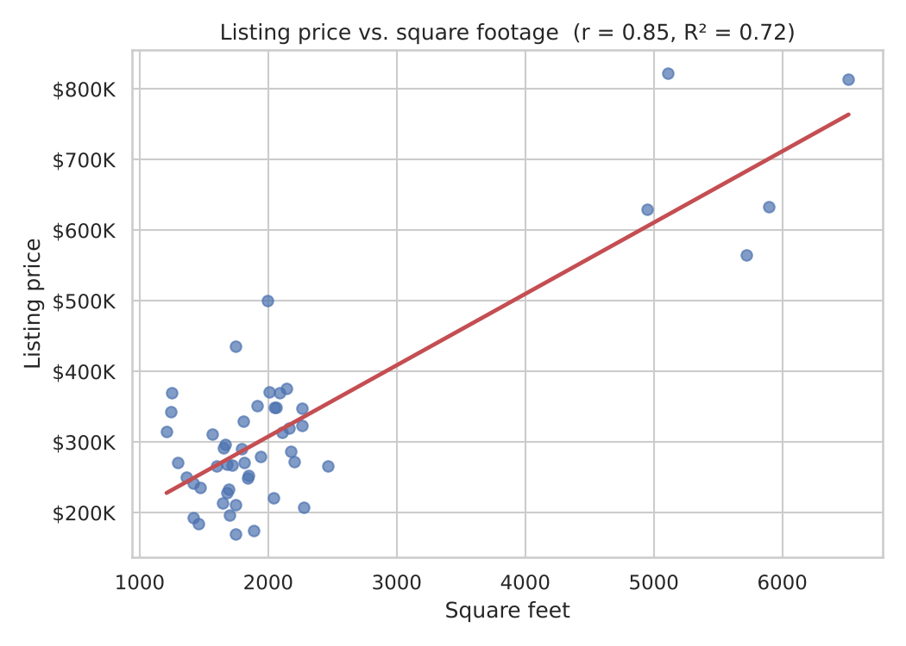

# U.S. Housing Price Analysis

Regression and hypothesis testing on U.S. home listing data, done in Python (pandas, SciPy, seaborn). Two questions:

1. **Can square footage predict a home's listing price?**
2. **Is the East North Central housing market (IL, IN, MI, OH, WI) different from the national market?**



## Key findings

| Question | Method | Result |
|---|---|---|
| Does square footage predict price? | Simple linear regression, n = 50 | ŷ = 100.99x + 106,007; r = 0.85, R² = 0.72 |
| How much does that depend on outliers? | Same model on homes under 4,000 sq ft, n = 45 | R² drops to **0.04** |
| Are East North Central prices lower than the national mean ($288,407)? | One-sample t-test, left-tailed, n = 500 | Mean ≈ $200,600; t = −23.42, p < 0.001 → **yes** |
| Is regional home size different from the national mean (1,944 sq ft)? | One-sample t-test, two-tailed, n = 500 | Mean ≈ 1,837 sq ft; t = −5.99, p < 0.001 → **yes, smaller** |
| What's the plausible range for regional home size? | 95% confidence interval | 1,802 – 1,872 sq ft |

**Takeaways**

- On the full sample, square footage looks like a strong predictor of price. A sensitivity check shows the fit comes mostly from five luxury homes. For typical homes, size alone explains very little of the price differences, so a useful pricing model needs location and other features.
- Homes in the East North Central region are cheaper and somewhat smaller than the national average. They are also cheaper per square foot (median ≈ $99/sq ft vs. ≈ $152 in the national sample).

## Data

| File | Description |
|---|---|
| `data/national_sample_50.csv` | Random sample of 50 U.S. listings (region, state, county, listing price, $/sq ft, square feet) |
| `data/east_north_central_sample_500.csv` | Random sample of 500 listings from the East North Central census region |

The source is realtor.com research data, provided as course material. Samples were drawn by assigning each row an Excel `RAND()` value, sorting, and keeping the first *n* rows. The national benchmark means ($288,407 and 1,944 sq ft) come from the national summary statistics provided with the dataset.

## Methods

- Descriptive statistics and distribution shape (both variables are right-skewed)
- Simple linear regression: slope, intercept, correlation, R², and a point prediction
- Sensitivity analysis that removes high-leverage outliers
- One-sample t-tests (left-tailed and two-tailed) at α = 0.05, with assumption checks (random sampling, independence, n large enough for the CLT)
- 95% t-based confidence interval

## Project structure

```
├── data/          # cleaned CSV samples
├── images/        # charts exported by the notebook
├── notebooks/
│   └── housing_analysis.ipynb
└── requirements.txt
```

## How to run

```bash
pip install -r requirements.txt
jupyter notebook notebooks/housing_analysis.ipynb
```

## Background

I first did this analysis in Excel for MAT 240 (Applied Statistics) in my B.S. in Data Analytics at Southern New Hampshire University. Here I rebuilt it in Python and added the outlier sensitivity check.

**Reinier Acosta Marrero** · [LinkedIn](https://www.linkedin.com/in/reinier-acosta-marrero/)
